  

  

 

##  Origin

I'm currently pursuing a **B.Tech in Information Technology at Vidyalankar Institute of Technology, Mumbai**, with a CGPI of 9.6, working at the point where **machine learning meets software engineering**.

I like to break a problem down until I understand the principle underneath it, then build the solution from an empty repository: schema first, then pipelines, then models, then something a real person can use. I care about transparent results, so my projects compare models against simple baselines and state their limits openly.

What follows is the story so far, told in the order I built it. The last chapter is still being written.

 

##  Chapter I · Learning to read data
DEC 2025

I started with raw business data and a question: *what is actually true in these numbers?* I learned to validate data in SQL before trusting any chart.

- [**Bank Loan Analysis**](https://github.com/HakimK438/bank-loan-analysis-postgreSQL-powerbi): my first complete analytics project. Loan performance, risk exposure and MTD trends in PostgreSQL and Power BI.
- [**E-commerce Revenue Intelligence**](https://github.com/HakimK438/Ecommerce-revenue-intelligence): revenue calculated twice and reconciled in SQL. If the numbers disagree, the dashboard doesn't get built.
- [**Customer Churn Behaviour**](https://github.com/HakimK438/customer-churn-behavior-analysis): finding *when* and *why* 7,043 customers leave, and which segments cost the most.

 

##  Chapter II · Teaching machines to predict
JAN – JUN 2026

Next came models, and the realisation that **accuracy alone doesn't tell the whole story**. On imbalanced data, the mistakes that matter are the expensive ones.

- [**Flight Delay Risk**](https://github.com/HakimK438/flight-delay-risk-classification): low / moderate / high risk using only pre-departure features, with leakage deliberately removed.
- [**Air Quality Prediction**](https://github.com/HakimK438/Air-Quality-Prediction): multi-class classification judged by macro-F1 and confusion matrices so hazardous cases aren't overlooked.
- [**ML Projects Portfolio**](https://github.com/HakimK438/machinelearning-projects-portfolio): ten end-to-end projects, from credit default to customer segmentation.
- [**Superconductor Tc**](https://github.com/HakimK438/Superconductor-Critical-Temperature-Prediction) and [**Online Shoppers**](https://github.com/HakimK438/Online-Shoppers-Purchase-Prediction): regression and classification on scientific and behavioural data.

 

##  Chapter III · Building complete systems
MAR – OCT 2026

Models alone don't help anyone, so I started building the whole system around them: databases, APIs, interfaces and tests. It began with a [**multi-mode reservation system**](https://github.com/HakimK438/Multi-Mode-ReservationSystem) and a [**hospital VLAN network**](https://github.com/HakimK438/Hospital-Network-Design-using-VLAN), and grew into these four products, each aimed at a problem I can see in Mumbai.

<table>
<tr>
<td width="50%" valign="top">

###  [AutoCART](https://github.com/HakimK438/AutoCART)
**Local stores, online.** A marketplace connecting shoppers with nearby Mumbai shops, with customer, seller and admin experiences.

- AI assistants **Saathi** and **Munim** that answer only from the live database
- Server-side checkout, per-store stock, store map, Razorpay test mode
- Seller onboarding, earnings dashboard, admin daily briefing
- 119 backend tests

   

</td>
<td width="50%" valign="top">

###  [iREPORT](https://github.com/HakimK438/iREPORT)
**Potholes to action.** Citizens report civic problems in a few taps, and ward offices work from a hazard-sorted control room.

- Duplicate detection within 50 m using PostGIS
- On-device ONNX models suggest a category, always marked unverified
- Full complaint lifecycle with citizen confirmation
- English, Hindi and Marathi

    

</td>
</tr>
<tr>
<td width="50%" valign="top">

###  [UPI Safety Check](https://github.com/HakimK438/upi-safety-check)
**Did the money really arrive?** A payment-safety tool for UPI merchants who face fake payment screenshots.

- Screenshot verification with on-device OCR, works offline
- Calibrated scam-message classifier
- UPI-ID look-alike detection and complaint drafting kit
- English and Hindi

   

</td>
<td width="50%" valign="top">

###  [India Weather Intelligence](https://github.com/HakimK438/india-weather-intelligence)
**21 years of sky, in a warehouse.** Hourly ERA5 weather for 10 Indian cities in a PostgreSQL star schema.

- Idempotent ETL with validation and quarantine
- SQL / OLAP analysis and materialised views
- Heat and heavy-rain models tested against baselines on a time-based split
- FastAPI dashboard, 30 tests

   

</td>
</tr>
</table>

 

##  Chapter IV · Signals from the lab
IN PROGRESS

Two experiments are taking shape right now. Open a signal to see what it's about.

 <b>Project IRIS</b> · <i>Can a machine see colour in the dark?</i>

 

Infrared cameras see what our eyes can't, but their images are grey, noisy and hard to read. IRIS is a deep-learning pipeline that **enhances infrared images and colourises them** into something a person can understand at a glance.

  

 <b>Project Autopilot</b> · <i>What if routine business work ran itself?</i>

 

Small businesses lose hours to repetitive tasks such as follow-ups, order updates and reports. This project connects **LLM agents with n8n workflows** so those tasks run on their own and a person steps in only when a decision is needed.

  

 Follow or star this profile to catch the next launch.

 

##  Toolkit

  
   
  

**Also:** Pandas · NumPy · XGBoost · PostGIS · SQLAlchemy · ONNX Runtime · REST APIs · LLM APIs

 

  

